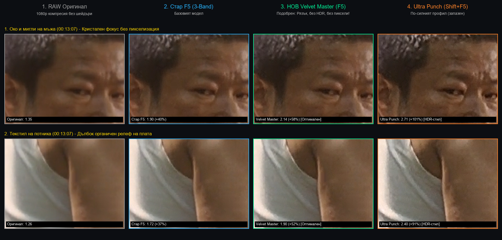
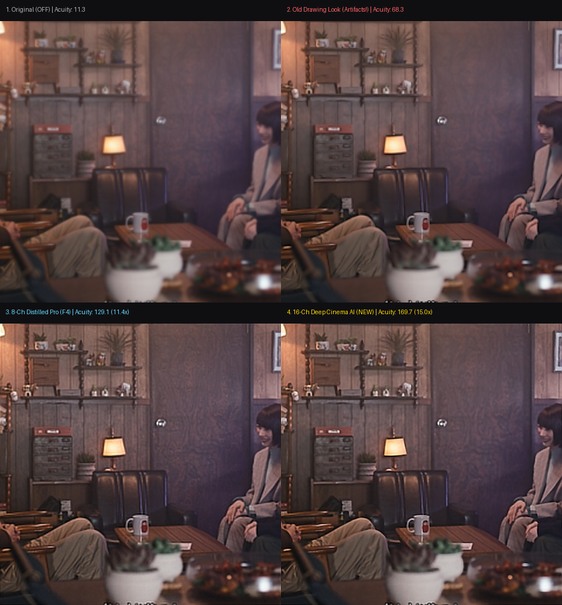

# MPV - Made Easy! (Ultimate Cinema Edition)

[](https://mpv.io/)
[](https://code.videolan.org/videolan/libplacebo)
[](https://microsoft.com/windows)
[](LICENSE.md)
[](#-cinema4k-real-time-shaders)

A fully configured, portable, high-performance **MPV** distribution designed to deliver the familiar, comfortable feel of **MPC-HC (Media Player Classic)** while leveraging the cutting-edge power of **`gpu-next`**, **libplacebo**, and **Cinema4K™ Studio Master Shaders**.

---

## 🌟 Key Highlights

* **Cinema4K™ Studio Engine**: Real-time GLSL video enhancement shaders engineered specifically for live-action cinema, movies, and compressed 1080p/720p content (Velvet Cinema Master, Ultra Dynamic Punch, 3-Band Master).
* **MPC-HC Experience**:
  * **Left-Click**: Single click to Play/Pause, Double-click for Fullscreen.
  * **Right-Click**: Full native Windows options menu with live checkmarks (tracks, shaders, filters, aspect ratio, playback rate).
* **Smart Subtitle Autoloader**: Auto-detects external subtitles in video directories and subfolders (`Subs/`, `Subtitles/`, etc.), with fuzzy episode matching and language priority (Bulgarian, English, etc.).
* **Secondary Subtitles**: Full support for bilingual subtitles with independent positioning (Top, Bottom, or Above primary) via `Alt+T` and instant swapping with `Alt+W`.
* **Audio Boost & Dialogue Clarity (`N` / `Ctrl+B`)**: MPC-HC style voice clarifier and normalizer with 5 switchable modes—no more inaudible dialogue or deafening explosions.
* **Single Instance & Auto-Resume**: Opens new files in the current window and automatically remembers playback position for every video.
* **100% Portable**: Self-contained in its folder—no registry bloat or mandatory `%APPDATA%` files required.

---

## 🎬 Cinema4K™ Real-Time Shaders

Engineered specifically for live-action films, TV series, and real-world compressed video. All modes are mapped to single-key shortcuts for instant A/B switching during playback:

| Key | Model | Characteristics |
| :---: | :--- | :--- |
| **`F4`** | **Cinema4K 3-Band Master** | **Classic Baseline Model** (Original Base). Multi-scale 3-band frequency decomposition (Micro, Cloth/Weave, Scene/Depth) for reliable 1080p live-action clarity. |
| **`F5`** | **Cinema4K Velvet Master** | **Flagship Natural Master** (Natural & Crisp). Engineered for organic film realism: selective meso-scale boost on fabrics and textures, sub-pixel anti-pixelation, zero haloing, and 100% preserved natural cinema lighting (no fake HDR distortion). |
| **`F6`** | **Cinema4K Ultra Dynamic Punch** | **High-Contrast Punch Model**. Anisotropic tangent flow steering and deep micro/macro-contrast enhancement with highlights protection for vivid, popping detail. |
| **`F3`** | **Cinema4K AI Neural 16ch** | **Experimental Neural 2x Model**. Deep 16-channel convolution pipeline for high-compression restoration. |
| **`F7`** *(or `Ctrl+0`)* | **Shaders OFF** | Instant shader bypass (returns to raw, unscaled video). |
| **`F10`** | **Active Shaders** | Displays an on-screen overlay of currently active GLSL shaders. |

> *Note: For 2D animated content, Anime4K presets remain accessible via `Ctrl+1` through `Ctrl+6`.*

### 📸 Visual Comparisons & Quality Showcase

#### 1. Velvet Cinema Master (`F5`) vs. Dynamic Punch (`F6`) vs. Original 1080p
Ultra-fine fabric texture extraction without halo artifacts, edge ringing, or artificial over-sharpening:


#### 2. Fine Detail & Meso-Scale Texture Reconstruction
Demonstrating micro-contrast depth, realistic film grain preservation, and facial contour refinement:


---

## ⌨️ Complete Keyboard & Mouse Shortcuts

### 🖱️ Mouse Controls
| Action | Function |
| :--- | :--- |
| **Left Click (Video)** | Play / Pause |
| **Left Double Click** | Toggle Fullscreen |
| **Right Click (Video or ⚙️ icon)** | Open / Close MPC-HC Style Context Menu |
| **Mouse Wheel** | Volume Up / Down (up to 200% boost) |
| **Thumb Side Buttons** | Skip to Previous / Next Chapter Marker |

### ⏯️ Playback & Navigation
| Key | Function |
| :--- | :--- |
| **`Space`** | Play / Pause |
| **`Left` / `Right` Arrow** | Seek 5 seconds Backward / Forward |
| **`Up` / `Down` Arrow** | Volume Up / Down (+5 / -5) |
| **`[` / `]`** | Playback Rate -10% / +10% |
| **`{` / `}`** | Playback Rate Half (0.5x) / Double (2.0x) |
| **`Backspace`** | Reset Playback Rate to 1.0x (Normal) |
| **`L`** | Toggle Repeat Single File (Infinite) |
| **`l`** *(lowercase L)* | A-B Repeat Loop (Set A -> Set B -> Clear) |
| **`Ctrl+G`** | Jump to specified timestamp |
| **`Ctrl+P`** | Open Interactive Playlist Manager |
| **`Enter` / `F11` / `F`** | Toggle Fullscreen |
| **`Alt+0` / `1` / `2` / `3`** | Window Zoom (50%, 100%, 200%, 300%) |
| **`Ctrl+T`** | Toggle Always on Top |
| **`M`** | Mute / Unmute |
| **`Alt+X` / `Q`** | Exit MPV |

### 💬 Subtitles & Languages
| Key | Function |
| :--- | :--- |
| **`S` / `Shift+S`** | Cycle Primary Subtitle Track Forward / Backward |
| **`Alt+S`** | Cycle Secondary Subtitle Track Forward |
| **`Alt+K`** | On-screen interactive subtitle track picker |
| **`Alt+T`** | Change Secondary Subtitle Position (Top / Below Primary / Above Primary) |
| **`Alt+W`** | Instantly Swap Primary and Secondary Subtitles |
| **`W` / `V`** | Toggle Primary Subtitles Visibility On / Off |
| **`Alt+V`** | Toggle Secondary Subtitles Visibility On / Off |
| **`Shift+G` / `Shift+F`** | Increase / Decrease Subtitle Size (+10% / -10%) |
| **`Z` / `Shift+Z`** | Subtitle Delay (-100ms / +100ms) |

### 🔊 Audio & Speech Enhancement
| Key | Function |
| :--- | :--- |
| **`A`** | Cycle Audio Tracks |
| **`N` / `Ctrl+B`** | Cycle Audio Boost & Dialogue Clarity Modes: <br> *(Dialogue Clarity -> Normalizer 400% -> High Speech Boost -> Night Mode -> OFF)* |
| **`Ctrl+E`** | Toggle 15-Band Graphic Equalizer overlay |
| **`Ctrl+D` / `Ctrl+Shift+D`** | Audio Delay (+100ms / -100ms) |

### 📷 Screenshots & Info
| Key | Function |
| :--- | :--- |
| **`Ctrl+S`** | Save screenshot (with subtitles) |
| **`Ctrl+Alt+S`** | Save clean screenshot (without subtitles) |
| **`Shift+F10`** | Show Media Properties overlay (Codecs, Bitrate, Resolution) |
| **`O`** | Toggle On-Screen Playback Info / Time OSD |
| **`F1` / `H`** | Show interactive keyboard shortcuts Help screen |

---

## 📦 Installation & Setup

1. **Download**: Download or clone this repository, or grab the latest release archive (`mpv-easy.zip`).
2. **Extract**: Unpack the files to your desired directory (e.g., `C:\Program Files\MPV\` or any portable drive).
3. **Register File Associations** *(Optional)*:
   * Right-click `installer\mpv-install.bat` and select **"Run as administrator"**.
   * Open Windows **Default Apps** settings and select MPV as your default player.
4. **Keeping Up-to-Date**:
   * Double-click [`updater.bat`](updater.bat) at any time. It will safely update `mpv.exe` and `yt-dlp.exe` to the newest upstream builds without touching your custom shaders, keybindings, or configuration files!

---

## 📂 Directory Structure

```text
MPV-Made-Easy/
├── mpv.exe                  # Main MPV video player executable (libplacebo gpu-next)
├── mpv.com                  # Console executable for debugging and CLI usage
├── d3dcompiler_43.dll       # DirectX HLSL shader compiler
├── updater.bat              # One-click automatic updater for MPV and yt-dlp
├── README.md                # Documentation & shortcut cheat-sheet
├── fonts/                   # High-legibility UI fonts & symbols (Source Sans, Noto)
├── installer/               # File association installer/uninstaller scripts
├── script-opts/             # Configuration for audio boost, equalizer & OSC
├── scripts/                 # Lua/JS scripts for context menu, subtitles & playlist
└── shaders/
    ├── Cinema4K/            # Studio Master shaders for live-action films & series
    │   ├── Cinema4K_Velvet_Cinema_Master.glsl      (F5: Flagship natural acutance)
    │   ├── Cinema4K_Ultra_Dynamic_Punch.glsl       (F6: High-contrast dynamic punch)
    │   ├── Cinema4K_3Band_Master_Original_Base.glsl (F4: Classic multi-scale base)
    │   └── Cinema4K_AI_Neural_16ch_2x.glsl         (F3: 16-channel convolution)
    └── Anime4K/             # Official Anime4K v4.0 restoration & upscaling presets
        ├── Anime4K_Clamp_Highlights.glsl
        ├── Anime4K_Restore_CNN_VL.glsl
        └── ...
```

---

## 🛡️ License & Commercial Rights

* **Cinema4K™ Video Shaders**: Copyright (c) 2026. Licensed under the **[PolyForm Noncommercial License 1.0.0](https://polyformproject.org/licenses/noncommercial/1.0.0/)** (see details in [LICENSE.md](LICENSE.md)).
  * **Personal & Non-Profit Use**: 100% Free for individuals to download, use, and evaluate.
  * **Commercial Use**: ANY commercial deployment (bundling into paid media software, video platforms, OTT streaming, hardware devices, or proprietary services) requires an express written **Commercial License Agreement** and payment of royalties. For inquiries, open an Issue/Discussion or contact the repository owner.
* **MPV Player**: Licensed under [GPLv3 / LGPLv2.1](https://github.com/mpv-player/mpv).
* **Anime4K**: Developed by [bloc97](https://github.com/bloc97/Anime4K) (MIT License).
* **ModernF OSC & Dynamic Menu**: Built with contributions from the open-source MPV community.
